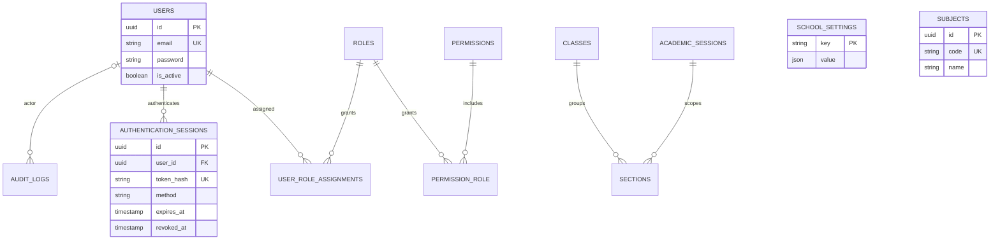

> Historical Phase 1/UI foundation record. Current complete mobile scope: [final report](final-mobile-report.md), [architecture](mobile-architecture.md) and [domain workflows](domain-workflows.md).

# Phase 1 architecture

Flutter → versioned Laravel JSON API → PostgreSQL. The API is suitable for a later desktop web client; no administration website exists yet.

Mobile separates `app/`, `core/`, `features/auth/`, `features/home/`, `l10n/`, `design/` and `shared/widgets/`. `AuthController` coordinates session restoration, login and revocation. `ApiClient` owns bounded HTTP requests and safe error categories. `SessionStore` is injectable and uses Android encrypted storage in the app. UI navigation derives from authenticated state, so the back button cannot restore a signed-out home page. Flutter's localization delegates supply Urdu text direction and platform material strings; app strings are centralized in bilingual dictionaries. No user data is available offline. Theme and locale are session preferences for now.

Laravel uses request validation, token middleware, a reusable permission middleware, a database permission resolver, transactional session/audit writes, and an idempotent reference-data seeder. Authorization grants are data-driven; no role has an implicit superuser bypass. Only Super Admin and School Administrator receive `settings.read` at present. Teacher, Coordinator, Accountant/Clerk and Parent/Guardian have no administrative grants. New modules must declare their own permissions and protect endpoints at the server. Current-user and logout endpoints require authentication, not an administrative role.

## Database relationships

UUIDs identify users, roles, permissions, sessions, audits and academic entities. Assignment/grant tables use composite primary keys. Settings use a unique semantic key. Users have unique email addresses; inputs and development provisioning normalize them to lowercase. Future user-management endpoints must preserve that invariant. Sections are unique per class, academic session and name. Classes are a grade catalog; sections are year-specific. Subjects remain a catalog until curriculum assignment is introduced later. Sessions have ordered dates enforced by PostgreSQL CHECK constraints. Foreign keys restrict deleting referenced academic records; user deletion removes sessions and role grants while anonymizing the audit actor reference. Audit events have no update endpoint; production database privileges should prevent audit mutation by runtime users.

Laravel scaffold cache/jobs tables remain as framework infrastructure and are not academic modules. API runs synchronously with file cache by default. Multiple API servers require a shared rate-limit cache (such as Redis); configure it before horizontal deployment.

## Authentication extension

Staff password validation is confined to the login controller. The reusable session verifier authenticates by token, expiry, revocation and account activity, regardless of credential method. Future CNIC/OTP verification should use a separate credential endpoint/service and issue `authentication_sessions` with its own `method`. Do not persist raw CNIC, OTP or token values in logs. No SMS provider or parent credential table is included now.

Concurrent logins are allowed. Each logout revokes only the presented session. Suspension blocks all sessions immediately; administrative suspension and password reset APIs are deferred. Expired/revoked session cleanup and audit retention require a deployment-specific retention policy; no destructive retention job is installed.

## UI session persistence

Remember Me is a mobile persistence choice, not a change to server authentication. The login form defaults to an in-memory token; selecting Remember Me writes the token through the existing SessionStore adapter. Deselecting it clears any previously persisted token after successful login. The server session expiry, revocation rules, API contract, RBAC and database schema are unchanged. Forgot Password displays administrator-contact guidance; it does not submit a nonexistent reset request. Future module cards expose no routes or actions.
