# Database schema and ER reference

UUIDs identify domain records; immutable registration/voucher/receipt numbers are operational identifiers. Foreign keys retain history. Money is integer PKR minor units. PostgreSQL adds partial unique, check, immutable-record and deferred journal-balance constraints.

MariaDB/MySQL equivalents are added by `2026_10_27_000014_add_mysql_integrity.php`: checks, invisible conditional unique keys, immutable-record/transition triggers, and transaction lock rows. Journal balance is validated atomically by `JournalService`; MariaDB has no deferred constraint trigger. See [the compatibility audit](database-compatibility-report.md).

| Table | Migration |
|---|---|
| users | 0001_01_01_000000_create_users_table.php |
| cache | 0001_01_01_000001_create_cache_table.php |
| cache_locks | 0001_01_01_000001_create_cache_table.php |
| jobs | 0001_01_01_000002_create_jobs_table.php |
| job_batches | 0001_01_01_000002_create_jobs_table.php |
| failed_jobs | 0001_01_01_000002_create_jobs_table.php |
| user_role_assignments | 2026_10_21_000001_create_foundation.php |
| permission_role | 2026_10_21_000001_create_foundation.php |
| school_settings | 2026_10_21_000001_create_foundation.php |
| academic_sessions | 2026_10_21_000001_create_foundation.php |
| classes | 2026_10_21_000001_create_foundation.php |
| sections | 2026_10_21_000001_create_foundation.php |
| subjects | 2026_10_21_000001_create_foundation.php |
| authentication_sessions | 2026_10_21_000001_create_foundation.php |
| audit_logs | 2026_10_21_000001_create_foundation.php |
| registration_sequences | 2026_10_21_000002_create_student_management.php |
| fee_categories | 2026_10_21_000002_create_student_management.php |
| students | 2026_10_21_000002_create_student_management.php |
| enrollments | 2026_10_21_000002_create_student_management.php |
| student_transitions | 2026_10_21_000002_create_student_management.php |
| parent_guardians | 2026_10_21_000002_create_student_management.php |
| parent_student_links | 2026_10_21_000002_create_student_management.php |
| staff_profiles | 2026_10_21_000002_create_student_management.php |
| class_subject_assignments | 2026_10_21_000002_create_student_management.php |
| teacher_assignments | 2026_10_21_000002_create_student_management.php |
| otp_challenges | 2026_10_21_000002_create_student_management.php |
| private_files | 2026_10_21_000003_create_private_files.php |
| school_days | 2026_10_21_000004_create_academic_workflows.php |
| attendance_registers | 2026_10_21_000004_create_academic_workflows.php |
| attendance_records | 2026_10_21_000004_create_academic_workflows.php |
| attendance_revisions | 2026_10_21_000004_create_academic_workflows.php |
| diary_entries | 2026_10_21_000004_create_academic_workflows.php |
| diary_students | 2026_10_21_000004_create_academic_workflows.php |
| diary_attachments | 2026_10_21_000004_create_academic_workflows.php |
| diary_revisions | 2026_10_21_000004_create_academic_workflows.php |
| grading_rules | 2026_10_21_000004_create_academic_workflows.php |
| assessments | 2026_10_21_000004_create_academic_workflows.php |
| assessment_results | 2026_10_21_000004_create_academic_workflows.php |
| assessment_revisions | 2026_10_21_000004_create_academic_workflows.php |
| behavior_observations | 2026_10_21_000004_create_academic_workflows.php |
| coordination_records | 2026_10_21_000004_create_academic_workflows.php |
| document_sequences | 2026_10_21_000005_create_financial_ledger.php |
| accounts | 2026_10_21_000005_create_financial_ledger.php |
| journal_entries | 2026_10_21_000005_create_financial_ledger.php |
| journal_lines | 2026_10_21_000005_create_financial_ledger.php |
| fee_schedules | 2026_10_21_000005_create_financial_ledger.php |
| student_fee_assignments | 2026_10_21_000005_create_financial_ledger.php |
| discount_policies | 2026_10_21_000005_create_financial_ledger.php |
| student_discounts | 2026_10_21_000005_create_financial_ledger.php |
| fee_invoices | 2026_10_21_000005_create_financial_ledger.php |
| invoice_lines | 2026_10_21_000005_create_financial_ledger.php |
| invoice_adjustments | 2026_10_21_000005_create_financial_ledger.php |
| payment_methods | 2026_10_21_000005_create_financial_ledger.php |
| payments | 2026_10_21_000005_create_financial_ledger.php |
| payment_allocations | 2026_10_21_000005_create_financial_ledger.php |
| payment_refunds | 2026_10_21_000005_create_financial_ledger.php |
| refund_allocations | 2026_10_21_000005_create_financial_ledger.php |
| expense_categories | 2026_10_21_000005_create_financial_ledger.php |
| expenses | 2026_10_21_000005_create_financial_ledger.php |
| staff_compensation | 2026_10_21_000005_create_financial_ledger.php |
| payroll_adjustments | 2026_10_21_000005_create_financial_ledger.php |
| payroll_periods | 2026_10_21_000005_create_financial_ledger.php |
| payroll_items | 2026_10_21_000005_create_financial_ledger.php |
| support_tickets | 2026_10_21_000007_create_school_communication.php |
| support_messages | 2026_10_21_000007_create_school_communication.php |
| support_message_attachments | 2026_10_21_000007_create_school_communication.php |
| support_ticket_events | 2026_10_21_000007_create_school_communication.php |
| support_ticket_forwards | 2026_10_21_000007_create_school_communication.php |
| announcements | 2026_10_21_000007_create_school_communication.php |
| announcement_reads | 2026_10_21_000007_create_school_communication.php |
| school_notifications | 2026_10_21_000007_create_school_communication.php |
| import_batches | 2026_10_21_000008_create_import_pipeline.php |
| biometric_mappings | 2026_10_21_000008_create_import_pipeline.php |
| biometric_punches | 2026_10_21_000008_create_import_pipeline.php |
| exam_schedules | 2026_10_21_000009_create_exam_schedule.php |
| push_devices | 2026_10_21_000010_create_push_delivery.php |
| push_deliveries | 2026_10_21_000010_create_push_delivery.php |

```mermaid
erDiagram
 USERS ||--o{ AUTHENTICATION_SESSIONS : authenticates
 USERS ||--o{ USER_ROLE_ASSIGNMENTS : receives
 ROLES ||--o{ USER_ROLE_ASSIGNMENTS : grants
 ROLES ||--o{ ROLE_PERMISSIONS : authorizes
 PARENT_GUARDIANS ||--o{ PARENT_STUDENT_LINKS : verifies
 STUDENTS ||--o{ PARENT_STUDENT_LINKS : links
 STUDENTS ||--o{ ENROLLMENTS : retains
 SECTIONS ||--o{ ENROLLMENTS : enrolls
 ACADEMIC_SESSIONS ||--o{ SECTIONS : schedules
 CLASSES ||--o{ SECTIONS : groups
 STAFF_PROFILES ||--o{ TEACHER_ASSIGNMENTS : teaches
 SECTIONS ||--o{ TEACHER_ASSIGNMENTS : assigns
 ATTENDANCE_REGISTERS ||--o{ ATTENDANCE_RECORDS : records
 STUDENTS ||--o{ ATTENDANCE_RECORDS : attends
 DIARY_ENTRIES ||--o{ DIARY_ATTACHMENTS : attaches
 PRIVATE_FILES ||--o{ DIARY_ATTACHMENTS : protects
 ASSESSMENTS ||--o{ ASSESSMENT_RESULTS : grades
 STUDENTS ||--o{ ASSESSMENT_RESULTS : receives
 STUDENTS ||--o{ FEE_INVOICES : owes
 FEE_INVOICES ||--o{ INVOICE_LINES : snapshots
 PAYMENTS ||--o{ PAYMENT_ALLOCATIONS : allocates
 FEE_INVOICES ||--o{ PAYMENT_ALLOCATIONS : settles
 PAYMENT_REFUNDS ||--o{ REFUND_ALLOCATIONS : reverses
 JOURNAL_ENTRIES ||--o{ JOURNAL_LINES : balances
 ACCOUNTS ||--o{ JOURNAL_LINES : posts
 PAYROLL_PERIODS ||--o{ PAYROLL_ITEMS : disburses
 SUPPORT_TICKETS ||--o{ SUPPORT_MESSAGES : converses
 SUPPORT_TICKETS ||--o{ SUPPORT_TICKET_EVENTS : tracks
 ANNOUNCEMENTS ||--o{ ANNOUNCEMENT_READS : acknowledges
 USERS ||--o{ SCHOOL_NOTIFICATIONS : receives
 PUSH_DEVICES ||--o{ PUSH_DELIVERIES : routes
 IMPORT_BATCHES ||--o{ BIOMETRIC_PUNCHES : preserves
 STUDENTS ||--o{ BIOMETRIC_MAPPINGS : maps
```

The migrations are authoritative for full column definitions, uniqueness, indexes and deletion policies. Framework cache/jobs tables are infrastructure, not school operational fixtures. Normal seeders install roles/reference settings only; test fixture seeding refuses every database except the isolated local `infotech_school_test`.

## Final RBAC/authentication/dashboard validation — 2026-10-23

Current results supersede earlier historical counts: PostgreSQL **118 tests / 864 assertions PASS**, Flutter **64 tests PASS**, analyze clean, Pint passed, three functional native cases passed across runs, emulator and phone normal-entry debug APKs built. See [final-auth-dashboard-report.md](final-auth-dashboard-report.md), [35-item RBAC report](final-rbac-report.md), [shared matrix](rbac-matrix.md) and their file inventories.

Applied `2026_10_22_000011_refine_staff_scopes`: coordinator_assignments, dated teacher assignments, verified parent links and announcement class/role targets; existing RBAC reused. Development migration count14, roles6, permissions19. No reset.

Local configuration caveat: invalid existing APP_KEY must be restored from original backup; not rotated. Separate isolated test key is not a replacement for the development key. No real data or secrets in reports.

## OTP/private-photo/visual follow-up — 2026-10-23

Current pass: PostgreSQL 129 tests/960 assertions PASS; Flutter 76 PASS; analyze/Pint/format clean; four functional native cases passed across runs; physical-phone debug APK built. See [final-media-report.md](final-media-report.md), [local OTP commands](local-parent-otp.md) and [file inventory](final-media-files.md). Current key/decrypt/lookup integrity checks pass; earlier APP_KEY-invalid notes describe the earlier session only.

Migration 2026_10_23_000012_add_guardian_profile_photos adds nullable UUID foreign references parent_guardians.photo_file_id and private_files.parent_guardian_id. No RBAC/secret storage replacement or development DB reset.

Guardian storage policy (28 October 2026): parent_guardians.cnic is a unique normalized 13-character identity, mobile is a readable +923 phone number. Both become NOT NULL after validated finalization. import_batches.source_rows holds readable temporary JSON. Legacy ciphertext/helper columns are retained only until school:convert-readable-data --drop-legacy succeeds. See [conversion procedure](readable-data-storage.md).

Manual finance completion: additive migration 000017 introduces immutable payroll_payments and payroll_payment_allocations. Each payment has a unique optional request UUID for legacy compatibility, a payload digest, method/date/notes and positive integer minor units; allocations reference existing payroll_items. New partial payments retain the approved period state until full settlement; the existing paid-state guard and immutable salary snapshots remain intact. Historical paid periods with no payment-history rows are read as fully paid without backfill or journal reposting. See [manual finance report](manual-finance-report.md).
